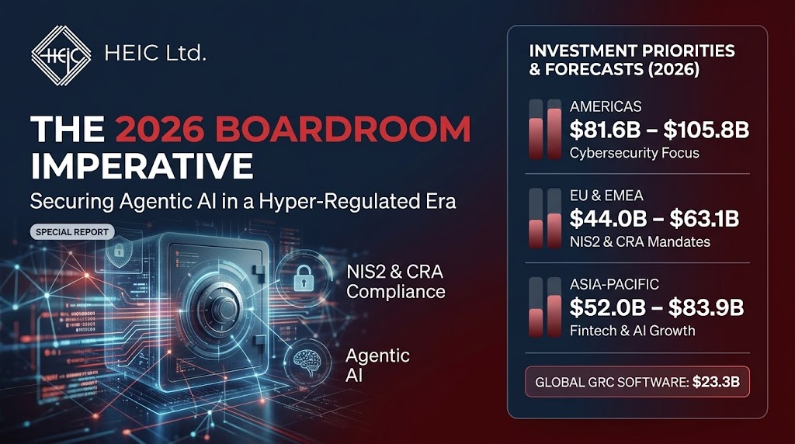
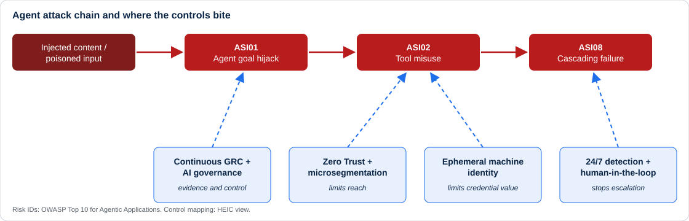

<h1 align="center">The 2026 Boardroom Imperative</h1>

<h3 align="center">Securing Agentic AI in a Hyper-Regulated Era</h3>

<em>Where cybersecurity and GRC capital needs to go as autonomous AI meets NIS2, the Cyber Resilience Act and DORA.</em>

---

> **TL;DR**
>
> - Agentic AI is moving from pilot to production while two EU laws put personal accountability and hard deadlines on security failures.
> - Capital should follow the *blast radius*: **(1)** Zero Trust and microsegmentation, **(2)** machine identity with ephemeral credentials, **(3)** continuous GRC plus AI governance, **(4)** detection capacity and human oversight.
> - Since **11 September 2026**, CRA vulnerability and incident reporting is no longer a future project. It is live.

## Contents

1. [Market signals](#1-market-signals)
2. [Regional spend: how to read the numbers](#2-regional-spend-how-to-read-the-numbers)
3. [Why agents change the threat model](#3-why-agents-change-the-threat-model)
4. [The regulatory stack](#4-the-regulatory-stack)
5. [Four investment priorities](#5-four-investment-priorities)
6. [Financial services: the trust premium](#6-financial-services-the-trust-premium)
7. [The supplier view: mid-market and outsourcing hubs](#7-the-supplier-view-mid-market-and-outsourcing-hubs)
8. [90-day board checklist](#8-90-day-board-checklist)
9. [Methodology and data notes](#9-methodology-and-data-notes)
10. [Sources](#10-sources)

---

## 1. Market signals

| Signal | Figure | Source |
| :-- | :-- | :-- |
| Worldwide IT spending, 2026 | **$6.37T, +14.2%**, revised up from $6.15T (+10.8%) in February; growth concentrated in AI infrastructure and software | [Gartner, Jul 2026](https://www.gartner.com/en/newsroom/press-releases/2026-07-27-gartner-forecasts-worldwide-it-spending-to-grow-14-point-2-percent-in-2026-totaling-6-point-37-trillion) |
| "Securing AI" market | **~$4.8B in 2027** (+68.7% on 2026); ~$7.7B by 2028 | [Gartner, Aug 2026](https://www.gartner.com/en/newsroom/press-releases/2026-08-26-gartner-forecasts-the-market-for-securing-ai-will-reach-almost-5-billion-in-2027) |
| Attacks on AI agents | Over half of successful attacks are predicted to exploit access-control weaknesses and prompt injection by 2029 | [Gartner, Aug 2026](https://www.gartner.com/en/newsroom/press-releases/2026-08-26-gartner-forecasts-the-market-for-securing-ai-will-reach-almost-5-billion-in-2027) |
| Global cybersecurity market | **~$212B in 2026** rising to ~$265B by 2030 (6.2% CAGR) | Statista Market Insights, via the Statista whitepaper |
| Top cyber-budget priority, 2026 | **AI: 36%**, ahead of cloud security (34%) and network security / zero trust (28%) | PwC, via the Statista whitepaper |
| CEO profitability lever, 2026 | **Business-model change: 51.5%** worldwide (U.S. 60.3%, Europe 44.4%, Asia 45.5%) | Bloomberg / S&P Global, via the Statista whitepaper |
| Agents vs. copilots (2025 spend) | Copilots **$7.2B** vs. agent platforms **$750M**; agents are roughly 10% of AI investment | Menlo Ventures, via the Statista whitepaper |
| Build vs. buy | 37% buy off-the-shelf AI today (Oct 2025), 32% build in-house | EY, via the Statista whitepaper |

**Reading across the rows:** AI is simultaneously the largest growth driver in IT budgets and the largest *new* attack surface. Agents are still a small share of spend, so most of the exposure is ahead of us, not behind us.

## 2. Regional spend: how to read the numbers

Published 2026 estimates of regional cybersecurity spend vary widely because publishers use different market definitions (software only, software plus services, hardware included).

| Region | 2026 published range | Dominant drivers |
| :-- | :-- | :-- |
| Americas | ~$81.6B - $105.8B | Hyperscale AI build-out, fast enterprise agent deployment, disclosure rules |
| EU and EMEA | ~$44.0B - $63.1B (see note) | NIS2, DORA, AI Act, CRA; data sovereignty; supplier audits |
| Asia-Pacific | ~$52.0B - $83.9B | Technology catch-up, fintech and digital payments, data-localisation rules |
| Global GRC software | ~$21B - $23.3B | Continuous control monitoring replacing spreadsheet compliance |

> [!NOTE]
> Treat these as **orders of magnitude, not benchmarks**. The lower EMEA bound comes from a forecast stated for a later horizon in the underlying research and is not strictly like-for-like with the 2026 upper bound. Anchor budget conversations on Gartner's figures in section 1 and on your own spend data.

## 3. Why agents change the threat model

A chatbot answers. An agent **plans, calls tools, holds memory, uses credentials and talks to other agents.** A successful injection against an agent with broad permissions is not a data leak. It is an insider acting with legitimate access.

The [OWASP Top 10 for Agentic Applications](https://genai.owasp.org/resource/owasp-top-10-for-agentic-applications-for-2026/) (published December 2025) names the new risk classes. Four matter most for a board conversation:

| OWASP ID | Risk | What it looks like in practice | Control family (HEIC view) |
| :-- | :-- | :-- | :-- |
| ASI01 | Agent Goal Hijack | An injected instruction redirects the agent's objective | Least privilege, goal and intent monitoring, human approval for irreversible actions |
| ASI02 | Tool Misuse and Exploitation | The agent abuses its own legitimate APIs and credentials | Scoped tool permissions, ephemeral credentials, rate and cost circuit breakers |
| ASI07 | Insecure Inter-Agent Communication | Agents trust each other's messages and memory | Authenticated agent-to-agent channels, segmentation |
| ASI08 | Cascading Failures | One compromised agent poisons its neighbours | Microsegmentation, kill switches, blast-radius limits |

The whitepaper adds the identity angle: attacks increasingly arrive through compromised login credentials, API keys or autonomous agents rather than classic hacks.

## 4. The regulatory stack

| Instrument | What it demands | Key dates and penalties |
| :-- | :-- | :-- |
| [**NIS2** - Directive (EU) 2022/2555](https://eur-lex.europa.eu/eli/dir/2022/2555/oj) | Art. 20: management bodies approve and oversee risk measures, are trained, and can be held liable. Art. 21: risk management incl. supply-chain security. Art. 23: **24 h** early warning, **72 h** notification, final report within **one month** | Fines up to **EUR 10M / 2%** of worldwide turnover (essential entities), **EUR 7M / 1.4%** (important entities) |
| [**CRA** - Regulation (EU) 2024/2847](https://eur-lex.europa.eu/eli/reg/2024/2847/oj) | Security by design and lifecycle updates for products with digital elements. Art. 14: report **actively exploited vulnerabilities** and **severe incidents** through ENISA's Single Reporting Platform, including for products already on the market | **Reporting live since 11 Sep 2026**; main obligations from **11 Dec 2027**; fines up to **EUR 15M / 2.5%** |
| [**DORA** - Regulation (EU) 2022/2554](https://eur-lex.europa.eu/eli/reg/2022/2554/oj) | ICT risk management, incident reporting and third-party oversight for financial entities | Applies since January 2025 |
| [**EU AI Act** - Regulation (EU) 2024/1689](https://eur-lex.europa.eu/eli/reg/2024/1689/oj) | Risk-based obligations for AI systems and general-purpose models | Phased application; check current timelines |

**Why this matters for agents:** one incident can start several clocks at once (NIS2, CRA, DORA, GDPR). Manual evidence gathering cannot meet a 24-hour early warning.

Official CRA reporting guidance: [European Commission - CRA reporting](https://digital-strategy.ec.europa.eu/en/policies/cra-reporting).

## 5. Four investment priorities

### 1. Zero Trust and microsegmentation
Assume any agent can be hijacked and design for containment. Authenticate and authorise every connection, and give each agent only the data zone its task needs. An agent that can reach the marketing dataset should be unable to reach the finance ledger.

### 2. Machine identity and ephemeral credentials
Non-human identities (API keys, service accounts, agent tokens) are growing faster than human accounts. Replace long-lived static keys with short-lived, task-scoped credentials that expire on completion, and make every agent identity inventoried and owned.

### 3. Continuous GRC and AI governance
Move from point-in-time audits to continuous control monitoring that ingests configuration, endpoint and identity data. Add runtime AI governance: decision logging, policy enforcement, cost circuit breakers. Anchor it in management-system standards so evidence is auditable:
[ISO/IEC 27001](https://www.iso.org/standard/27001) (information security), [ISO/IEC 42001](https://www.iso.org/standard/81230.html) (AI management systems) and the [NIST AI Risk Management Framework](https://www.nist.gov/itl/ai-risk-management-framework).

### 4. Detection capacity and human oversight
Skills, not only tools, are the bottleneck. In the Dynatrace data cited by Statista, a shortage of skilled staff is a barrier for **51%** of leaders in the Americas, **46%** in Asia-Pacific and **39%** in EMEA, while **50%** in EMEA cite managing and monitoring agents at scale. Combine managed detection and response for 24/7 coverage with in-house AI fluency and human-in-the-loop approval for irreversible financial or strategic actions.

## 6. Financial services: the trust premium

- **57%** of financial-services leaders rank cybersecurity as the top strategic investment priority, versus **43%** across all industries (Protiviti / NC State, via Statista).
- Trust is a bank's most valuable asset. Agentic systems fed biased or incorrect data can deny loans unfairly or trigger unauthorised transactions, turning a technical failure into a reputational one.
- Yet **56%** of banking leaders rate agentic AI as *highly capable* of improving fraud detection and **51%** of improving IT and security risk management (EY / MIT Technology Review Insights, 2025). The same technology defends and exposes.
- Statista's conclusion: prioritise **operational strategy over technology strategy**, and align functions across the organisation.

## 7. The supplier view: mid-market and outsourcing hubs

NIS2 Article 21 requires entities to manage supply-chain risk. In practice, software houses and managed service providers feel NIS2 and the CRA **through customer contracts** even when they are not directly in scope: questionnaires, audit rights, evidence of vulnerability handling and incident-reporting readiness.

For suppliers serving European enterprise customers (including the large outsourcing ecosystems in Central and Eastern Europe), the practical response is a certifiable management system, a tested incident-reporting process, and an inventory of the AI agents and tools used in service delivery.

## 8. 90-day board checklist

- [ ] Inventory every AI agent in production and pilot: owner, purpose, tools, data access, credentials
- [ ] Define the **maximum blast radius** per agent and enforce it with segmentation and scoped permissions
- [ ] Replace static API keys used by agents with short-lived credentials
- [ ] Name the person who decides whether an event meets NIS2 / CRA reporting thresholds, and rehearse a **24-hour early warning**
- [ ] Document management-body approval, oversight and training (NIS2 Art. 20) as auditable evidence
- [ ] Add decision logging and cost circuit breakers to agentic workflows
- [ ] Map customer and supplier contractual security requirements that will flow down to you
- [ ] Decide which processes must keep a human approval step

## 9. Methodology and data notes

This dossier synthesises three inputs: the Statista finance whitepaper *Investment Priorities 2026: Putting Agentic AI to Work*, an independent research report on cybersecurity, GRC and agentic AI investment, and HEIC's infographic. Key figures were cross-checked against primary publications (Gartner, EUR-Lex, European Commission, OWASP). Where inputs disagreed, the primary or most specific source was used:

- **IT spending:** Gartner issued successive forecasts ($6.15T in February, $6.31T in April, $6.37T in July). These are revisions of one forecast, not a range; the latest is used.
- **Banking capability survey:** 56% relates to fraud detection and 51% to IT and security risk management; customer experience scored 41%.
- **Consumer AI use:** 56% use AI as an information source, 45% as an everyday assistant.
- **Buy vs. build:** 37% buying off-the-shelf in October 2025 (40% in October 2024).
- **OWASP identifiers:** one input mixed identifiers between LLM Top 10 editions. This page cites Agentic Top 10 IDs only where verified and otherwise uses risk names.
- **Excluded:** vendor-blog statistics (for example microsegmentation ROI multiples and NIS2 cost bands) and growth figures that did not match Gartner's own releases.
- **Added:** CRA Article 14 reporting start (11 September 2026), which is not covered in the inputs.
- **Regional ranges** (section 2) come from commercial market-research publishers with differing definitions and are indicative only.

*This page is informational and is not legal advice. Confirm regulatory obligations against the official texts and your national competent authority.*

## 10. Sources

### Regulation and official guidance
| Source | Link |
| :-- | :-- |
| NIS2 Directive (EU) 2022/2555 | [EUR-Lex](https://eur-lex.europa.eu/eli/dir/2022/2555/oj) |
| Cyber Resilience Act (EU) 2024/2847 | [EUR-Lex](https://eur-lex.europa.eu/eli/reg/2024/2847/oj) |
| CRA reporting obligations | [European Commission](https://digital-strategy.ec.europa.eu/en/policies/cra-reporting) |
| DORA (EU) 2022/2554 | [EUR-Lex](https://eur-lex.europa.eu/eli/reg/2022/2554/oj) |
| EU AI Act (EU) 2024/1689 | [EUR-Lex](https://eur-lex.europa.eu/eli/reg/2024/1689/oj) |
| ENISA | [enisa.europa.eu](https://www.enisa.europa.eu) |

### Analysts and security frameworks
| Source | Link |
| :-- | :-- |
| Gartner: IT spending, $6.37T, July 2026 | [Press release](https://www.gartner.com/en/newsroom/press-releases/2026-07-27-gartner-forecasts-worldwide-it-spending-to-grow-14-point-2-percent-in-2026-totaling-6-point-37-trillion) |
| Gartner: IT spending, $6.15T, February 2026 | [Press release](https://www.gartner.com/en/newsroom/press-releases/2026-02-03-gartner-forecasts-worldwide-it-spending-to-grow-10-point-8-percent-in-2026-totaling-6-point-15-trillion-dollars) |
| Gartner: securing AI market, August 2026 | [Press release](https://www.gartner.com/en/newsroom/press-releases/2026-08-26-gartner-forecasts-the-market-for-securing-ai-will-reach-almost-5-billion-in-2027) |
| OWASP Top 10 for Agentic Applications | [OWASP GenAI Security Project](https://genai.owasp.org/resource/owasp-top-10-for-agentic-applications-for-2026/) |
| OWASP Top 10 for LLM Applications | [OWASP GenAI Security Project](https://genai.owasp.org/llm-top-10/) |
| ISO/IEC 27001, ISO/IEC 42001 | [ISO](https://www.iso.org/standard/27001) / [ISO](https://www.iso.org/standard/81230.html) |
| NIST AI RMF | [NIST](https://www.nist.gov/itl/ai-risk-management-framework) |

### Market data
| Source | Link |
| :-- | :-- |
| Statista, *Investment Priorities 2026: Putting Agentic AI to Work* (finance whitepaper), incl. PwC, Protiviti / NC State, EY / MIT TR, Menlo Ventures, Dynatrace, Deloitte, McKinsey | [statista.com](https://www.statista.com) |
| Statista Market Insights: Cybersecurity | [statista.com](https://www.statista.com) |
| Regional cybersecurity and GRC market reports (Fortune Business Insights, Precedence Research, MarketsandMarkets, Mordor Intelligence) | Indicative ranges only; see section 2 |

---

<b>Alexander Atanassov</b> - Lead Auditor and GRC Consultant, <a href="https://github.com/YOUR-ORG">HEIC Ltd.</a> 
Quality - Information Security - AI Governance - Integrated Management Systems 
 
&copy; 2026 HEIC Ltd. Shared for information purposes.

